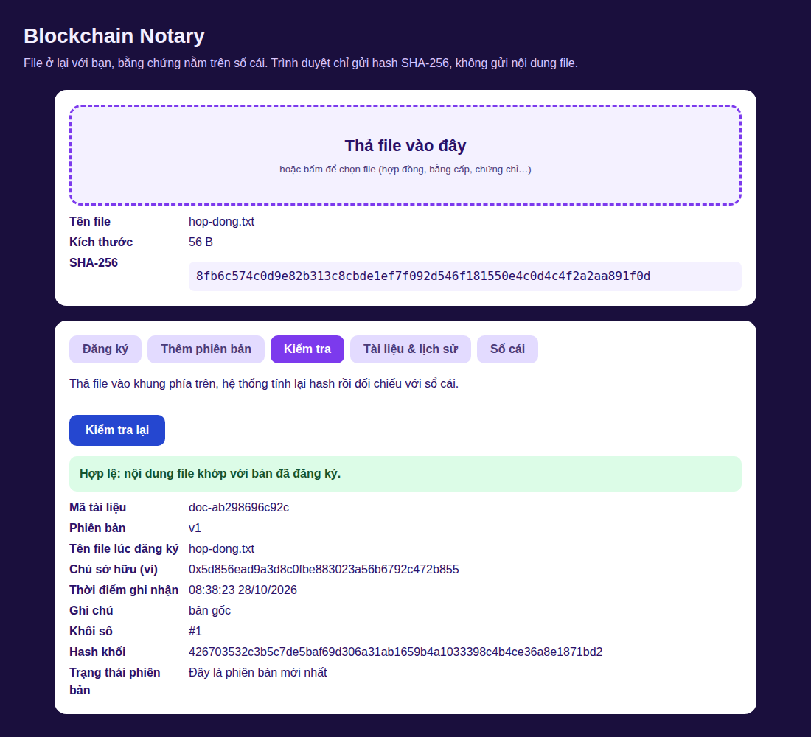
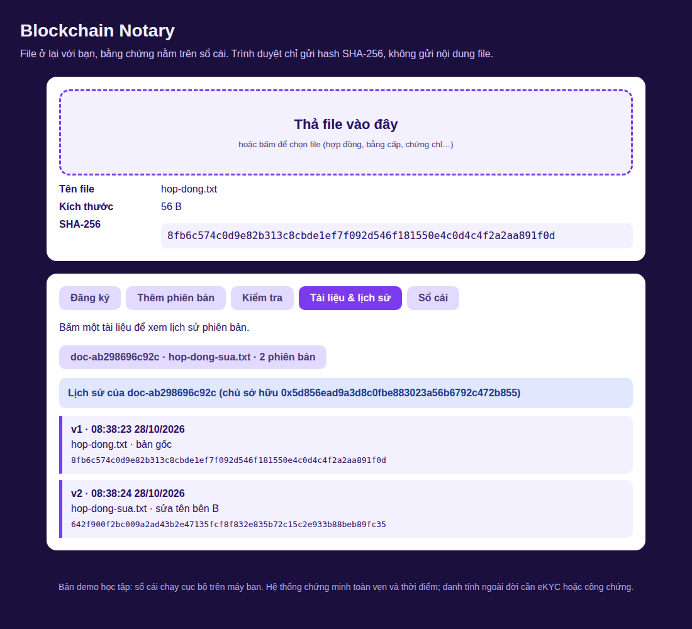

# Blockchain Notary (Java)

Công chứng và xác thực tài liệu số bằng sổ cái chuỗi khối. Bài tập lớn môn Công nghệ Blockchain, Khoa Công nghệ Thông tin, Trường Đại học Hải Phòng.

> **File ở lại với bạn, bằng chứng nằm trên sổ cái.** Trình duyệt tính SHA-256 ngay trên máy, chỉ hash 32 byte được gửi đi. File gốc không bao giờ rời khỏi máy người dùng.



## Đáp ứng 7 yêu cầu của báo cáo

| # | Yêu cầu | Cách thực hiện | Nơi trong mã |
|---|---|---|---|
| 1 | Hash file | SHA-256 tính bằng Web Crypto ngay trong trình duyệt | `index.html` (`sha256Hex`), `Crypto.java` |
| 2 | Timestamp | Thời điểm khối được ghi vào sổ cái (UTC, mili-giây), nằm trong hash khối | `Block.java`, `Ledger.seal` |
| 3 | Owner | Địa chỉ ví (từ khóa công khai EC secp256r1); mỗi bản ghi mang chữ ký ECDSA của chủ sở hữu | `Wallet.java`, `Ledger.validate` |
| 4 | Verify | `GET /api/verify?hash=…`: so khớp hash, báo chủ sở hữu, thời điểm, phiên bản | `Server.verifyJson` |
| 5 | Lịch sử phiên bản | Mỗi tài liệu có `docId` cố định; `POST /api/version` thêm bản mới, chỉ owner được thêm, không xóa hay ghi đè bản cũ | `Ledger.addVersion` |
| 6 | Không đưa file gốc lên blockchain | Máy chủ chỉ nhận hash (giới hạn 64 KB mỗi yêu cầu), sổ cái chỉ lưu hash, tên file, kích thước | `Server.readBody` |
| 7 | Giao diện kéo-thả để kiểm tra | Trang web có vùng thả file, 5 tab: Đăng ký, Thêm phiên bản, Kiểm tra, Tài liệu và lịch sử, Sổ cái | `src/main/resources/web/index.html` |

Ngoài ra sổ cái tự kiểm tra tính toàn vẹn: mỗi khối chứa hash khối trước, nên sửa một khối cũ sẽ bị phát hiện (tab **Sổ cái** báo "không hợp lệ").

## Chạy nhanh

Cần **JDK 17 trở lên**. Không cần Maven, Gradle hay thư viện ngoài.

```bash
git clone https://github.com/<tai-khoan>/<ten-repo>.git
cd <ten-repo>
./run.sh            # Windows: run.bat
```

Mở trình duyệt tại **http://127.0.0.1:8080** (dùng đúng địa chỉ `127.0.0.1` hoặc `localhost` để trình duyệt cho phép Web Crypto).

Đổi cổng: `./run.sh 9000` hoặc `PORT=9000 ./run.sh`. Dữ liệu lưu trong thư mục `data/` (đổi bằng biến `NOTARY_DATA`).

### Thử nhanh theo kịch bản trong báo cáo

1. Tab **Đăng ký**: thả một file, chọn ví `demo`, bấm **Công chứng**.
2. Tab **Kiểm tra**: thả lại đúng file đó, kết quả **Hợp lệ** kèm chủ sở hữu, thời điểm, phiên bản.
3. Sửa file (chỉ một ký tự) rồi thả vào tab **Kiểm tra**, kết quả **Không tìm thấy**.
4. Tab **Thêm phiên bản**: thả file đã sửa, chọn tài liệu, bấm thêm. Tab **Tài liệu và lịch sử** hiển thị v1, v2.
5. Thả file gốc ban đầu vào tab **Kiểm tra**, hệ thống báo đây là bản cũ.



## Kiểm thử

```bash
./test.sh
```

22 phép kiểm tra: vector chuẩn SHA-256, đăng ký, owner, timestamp, từ chối trùng hash, thêm phiên bản (kể cả bị từ chối khi không phải chủ sở hữu), verify, lưu và đọc lại, phát hiện sửa dữ liệu, và các API HTTP. Cùng bộ kiểm thử này chạy tự động trên GitHub Actions (`.github/workflows/build.yml`).

## API

| Phương thức | Đường dẫn | Tham số | Ý nghĩa |
|---|---|---|---|
| GET | `/api/wallets` | | Danh sách ví demo |
| POST | `/api/wallets` | `name` | Tạo ví mới |
| POST | `/api/register` | `hash`, `fileName`, `size`, `wallet`, `note` | Đăng ký tài liệu mới (phiên bản 1) |
| POST | `/api/version` | `docId`, `hash`, `fileName`, `size`, `wallet`, `note` | Thêm phiên bản mới |
| GET | `/api/verify` | `hash` | Kiểm tra một hash |
| GET | `/api/doc` | `id` | Lịch sử phiên bản của một tài liệu |
| GET | `/api/docs` | | Danh sách tài liệu |
| GET | `/api/chain` | | Toàn bộ sổ cái và kết quả kiểm tra tính hợp lệ |

Ví dụ với `curl`:

```bash
H=$(sha256sum hop-dong.pdf | cut -d' ' -f1)
curl -X POST localhost:8080/api/register -d "hash=$H&fileName=hop-dong.pdf&size=1234&wallet=demo&note=ban+goc"
curl "localhost:8080/api/verify?hash=$H"
```

## Cấu trúc

```
src/main/java/vn/edu/notary/
  Main.java          Khởi động
  Server.java        Máy chủ HTTP (com.sun.net.httpserver) + REST API
  Ledger.java        Sổ cái: đăng ký, phiên bản, verify, kiểm tra toàn vẹn, lưu file
  Block.java         Cấu trúc một khối và cách tính hash khối
  Crypto.java        SHA-256, khóa EC, chữ ký ECDSA
  Wallet*.java       Ví demo
src/main/resources/web/index.html   Giao diện kéo-thả
src/test/java/vn/edu/notary/SelfTest.java
```

## Giới hạn (nói thẳng)

- **Đây là sổ cái cục bộ mô phỏng blockchain**, không phải mạng công khai như Ethereum. Nó minh hoạ đúng cơ chế (hash, chuỗi khối, chữ ký, phiên bản) nhưng bằng chứng chỉ đáng tin trong phạm vi người vận hành máy chủ. Muốn có bằng chứng công khai, cần ghi hash lên mạng thật (xem hướng mở rộng).
- **Timestamp lấy từ đồng hồ máy chủ**, không phải thời gian khối của mạng công khai.
- **Ví là ví demo do máy chủ giữ khóa** (để chạy được không cần MetaMask). Hệ thống thật phải để người dùng tự ký bằng ví của họ.
- Ví chưa gắn với danh tính ngoài đời. Ai đăng ký hash trước sẽ được ghi là owner (rủi ro đăng ký chiếm trước). Cần eKYC hoặc chữ ký số để gắn với người thật.
- Hệ thống chứng minh **toàn vẹn và thời điểm**, không thay thế công chứng theo luật định.
- Đổi một bit là hash khác: file nén lại hoặc lưu lại sẽ không khớp.
- Web Crypto đọc cả file vào bộ nhớ, nên file rất lớn có thể chậm.
- Máy chủ mặc định chỉ lắng nghe `127.0.0.1`. Không mở ra Internet khi chưa có xác thực người dùng.

## Hướng mở rộng

- **Ghi lên Ethereum (Sepolia):** thay `Ledger` bằng một smart contract có `registerDocument`, `addVersion`, `verifyDocument` và event `Notarized`, gọi từ Java bằng Web3j.
- **Lưu file ngoài chuỗi bằng IPFS:** gọi Kubo RPC (`/api/v0/add`) qua `java.net.http.HttpClient`, tương tự thư viện tham khảo [js-kubo-rpc-client](https://github.com/ipfs/js-kubo-rpc-client). File phải được mã hoá trước khi tải lên vì IPFS là mạng công khai.
- Tích hợp VNeID/eKYC để gắn ví với danh tính; chuyển sang Layer 2 để giảm phí.

## Giấy phép

MIT, xem file `LICENSE`.
